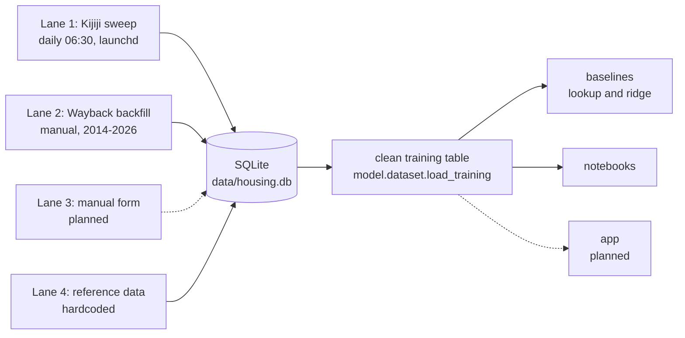
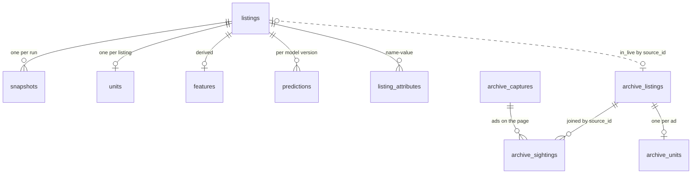

# Architecture

Written 2026-11-03, after the resilience overhaul. This is the map of the system for a new
teammate; the write-rule contract per step lives in `docs/pipeline.md`, the product and schema
contracts in `HANDOFF.md` (sections 2, 3 and 5), and every non-trivial call in
`docs/decisions.md`. When this document and the code disagree, the code and `decisions.md` win;
fix this file.

## 1. System overview

A fair-price check for Waterloo student rentals, built data-science-first: the pipeline exists
to produce one clean training table of Kitchener-Waterloo listings, a model predicts what a
unit should rent for per bedroom, and a small app (planned, Phase 3) will score one listing
against it. Until the model lands, the deliverables are the data itself, two recorded baselines
and the notebooks.

Four lanes feed one SQLite file, `data/housing.db`:

1. **Live Kijiji sweep** — four markets since 2026-11-06 (Kitchener-Waterloo, Guelph,
   Hamilton, London; both categories each, `daily.SWEEP_PLAN`), daily at 06:30 via a macOS
   launchd job. Fully automated: sweeps, gone-marking, detail pages, extraction, dedup,
   features, Discord report. Each listing's market is stored as the `location` attribute;
   the product remains a Waterloo fair-price check — the extra markets feed the model.
2. **Wayback backfill** — archived captures of the same index pages, 2014 to 2026, and of
   individual ad pages (full descriptions, stored scrubbed), into the separate `archive_*`
   tables (9,316 unique past ads; see `docs/sources.md` section 7). Built; run manually,
   paced at one request per 15 to 20 seconds for archive.org.
3. **Manual-entry form** — planned: a form writing rows with `source = 'manual'` so team
   members can capture Facebook-group listings by reading them as humans.
4. **Reference data** — hardcoded: campus coordinates, the 19 ION LRT stations (from GTFS),
   CMHC anchors for sanity checks.



Archive rows and snapshots are history, never training rows; the clean table is built from
unique live listings only.

## 2. Module map

Everything the pipeline depends on lives in `src/housing/`; notebooks only import it.

| Module | Responsibility |
|---|---|
| `housing.paths` | Repo-anchored locations (`data/`, the DB, the schema file); loads `.env` on import; `HOUSING_DATA_DIR` / `HOUSING_DB_PATH` overrides |
| `housing.schema` | Loads and validates the unit-schema contract `schema/unit_schema.yaml` |
| `housing.notify` | Posts run reports to the Discord webhook; logs and carries on when no webhook is set |
| `housing.scrape.fetch` | The polite fetcher every scraper uses: rate limiting, robots.txt, retries, raw gzip storage, `keep_awake` (caffeinate), `wait_for_network` (DNS) |
| `housing.scrape.kijiji` | The live sweep (`sweep`) and the detail-page pass (`fetch_details`), with partial-stats semantics |
| `housing.scrape.daily` | Orchestrates the whole daily run in order, grades the exit code, builds the report |
| `housing.scrape.wayback` | Wayback CDX API client: list the archived captures of a URL pattern |
| `housing.scrape.backfill` | The archive lane: inventory, paced download, re-parse, `archive_units` extraction, summary of `archive_*` |
| `housing.scrape.rescrub` | Re-applies the current PII rules to stored raw pages (`--dry-run`, `--backup`) |
| `housing.parse.kijiji` | Parses live index and detail pages from the embedded `__NEXT_DATA__` JSON |
| `housing.parse.archive` | Classifies archived index pages into five layout eras and ad pages into two, and parses or scrubs each |
| `housing.parse.units` | Maps attributes plus title/description text to the section 3 unit fields |
| `housing.parse.extract` | Runs the unit extraction over the database into `units` and `text_*` flags |
| `housing.parse.pii` | The privacy rule: contact stripping, whole-page scrubbing, URL redaction, salted poster-id hashing |
| `housing.features.dedup` | One `dedup_key` per physical unit: normalized address, geo-grid fallback |
| `housing.features.build` | Drops and rebuilds the derived `features` table |
| `housing.geo.distances` | Haversine walking minutes to UW and Laurier |
| `housing.geo.ion_stops` | Hardcoded ION stations and nearest-stop lookup |
| `housing.db` | `connect()` with the per-connection conventions: foreign keys on, WAL, 60 s busy timeout |
| `housing.db.migrate` | Applies `schema.sql`, tracks the version in `PRAGMA user_version`, guarded one-time steps |
| `housing.db.queries` | Read/write helpers for the contract tables: upserts, `mark_gone`, pending details, restrip |
| `housing.model.dataset` | `load_training`: the Phase 1c clean training frame, cleaning counted per rule; read-only |
| `housing.model.evaluate` | MAE/MAPE metrics, grouped CV by `dedup_key`, time split by `first_seen` |
| `housing.model.baseline` | The two baselines the model must beat: median lookup and ridge |
| `housing.app` | Empty placeholder for Phase 3 |

CLI entry points (all take `--db`; `--help` on any of them lists the rest):

| Command | Purpose |
|---|---|
| `python -m housing.scrape.daily` | The whole daily run: sweep, gone rule, details, extraction, dedup, features, report |
| `python -m housing.scrape.kijiji` | Index sweep only, optionally `--details N` |
| `python -m housing.scrape.backfill` | Wayback lane: `--inventory`, `--download N`, `--rebuild`, `--summary` |
| `python -m housing.parse.extract` | Unit-field extraction; `--all` re-extracts everything after a rule change |
| `python -m housing.features.dedup` | Fill `listings.dedup_key` and report sharing |
| `python -m housing.features.build` | Rebuild the derived `features` table |
| `python -m housing.model.baseline` | Grouped-CV and time-split errors for the lookup and ridge baselines |
| `python -m housing.db.migrate` | Create or update the database; prints tables with row counts |
| `scripts/sweep.py` | What launchd runs; equivalent to `housing.scrape.daily` |
| `scripts/make_fixture.py` | Copy a raw page into `tests/fixtures/` with poster ids faked and client ids blanked |
| `scripts/scrub_raw.py` | Scrub raw pages saved before the fetcher scrubbed on the way in |
| `scripts/restrip.py` | Re-apply the contact-stripping rules to stored rows after they get stricter |
| `scripts/export_sample.py` | Write the committed 100-row `data/sample.csv` (PII-safe, address dropped) |
| `scripts/field_audit.py` | Rewrite `docs/field_audit.md`: field coverage per category from the DB |
| `scripts/wayback_count.py` | Size the Wayback history with four CDX queries; Markdown table out |
| `scripts/install_launchd.sh` | Render the plist template and install the 06:30 launchd job |

Run every command through `uv run` (e.g. `uv run python -m housing.scrape.daily`).

## 3. Data model

Five contract tables (HANDOFF section 5, DDL verbatim in `src/housing/db/schema.sql`) plus four
auxiliary tables added by logged decisions:

- **listings** — one row per ad per source, `UNIQUE(source, source_id)`; carries `status`
  (`active`/`gone`), `dedup_key`, and text with contact info already stripped.
- **snapshots** — one sighting per listing per run with the card price; unique per
  `(listing_id, scraped_at)` since schema version 4, so a retried category updates rather than
  duplicates. History, never training rows.
- **units** — the section 3 unit fields, one row per listing, rewritten on every extraction.
- **features** — derived values (target, walk minutes, ION distance, neighbourhood, days on
  market); dropped and rebuilt freely.
- **predictions** — batch scores per listing per model version. Reserved for the real model;
  nothing writes it yet (the baselines deliberately do not).
- **listing_attributes** — every raw source attribute plus our own flags (`category`,
  `poster_hash`, `detail_*` bookkeeping, `text_*` extraction flags), one row per
  `(listing_id, name)`.
- **archive_captures** — the backfill's work queue: one row per archived page with status,
  format and provenance; `kind` says whether it is an index page or one ad's page.
- **archive_sightings** — one row per ad per capture, the archive's snapshots.
- **archive_listings** — one row per past ad however many captures show it, with first/last
  price, the version 4 columns `neighbourhood` (postal prefix from the address) and
  `intersection` (classic and v2 cards carry one), and the version 5 `description` (full ad
  text when an ad page was captured, contact-stripped).
- **archive_units** — the section 3 unit fields per archived ad, rewritten by
  `backfill.extract_units` on every run from the live extraction rules; the training
  frame's archive rows read these, exactly as live rows read `units`.



Who writes what:

| Table | Written by |
|---|---|
| `listings` | `scrape.kijiji` (sweep upsert, detail fill-ins), `db.queries.mark_gone` (called by `scrape.daily`), `features.dedup` (`dedup_key`), `scripts/restrip.py` |
| `snapshots` | `scrape.kijiji.sweep` via `db.queries.insert_snapshot` (upsert) |
| `units` | `parse.extract` via `db.queries.upsert_units` |
| `features` | `features.build` (drop and rebuild) |
| `predictions` | nothing yet |
| `listing_attributes` | `scrape.kijiji` (card and detail attributes), `parse.extract` (`text_*` flags) |
| `archive_captures` | `scrape.backfill` (inventory and per-capture status) |
| `archive_sightings` | `scrape.backfill` (`record_cards`, `record_ad`) |
| `archive_listings` | `scrape.backfill` (`record_cards`, `record_ad`, `refresh_listings`) |
| `archive_units` | `scrape.backfill.extract_units` (drop and rebuild, like `units`) |

Schema versions (`PRAGMA user_version`, history in `housing.db.migrate`): **1** the five
section 5 tables (2026-10-04); **2** adds `listing_attributes` (2026-10-14); **3** adds the
Wayback `archive_*` tables (2026-10-16); **4** snapshots unique per `(listing_id, scraped_at)`
with a one-time dedupe, and `archive_listings` gains `neighbourhood` and `intersection`
(2026-11-03); **5** archived ad pages: `archive_captures.kind`, `archive_listings.description`
and `archive_units` (2026-11-08) — run `backfill --rebuild` (or any backfill run) once after
upgrading so `archive_units` fills. The contract DDL stays byte-identical; the unique index
and the guarded `ALTER`s live in `migrate.py`.

**Archive-live link.** `archive_listings.in_live` is set to 1 by
`backfill.refresh_listings` when the daily sweep has the same Kijiji ad id, so the two sources
are never added together; archive counts and the price index use archive-only ads.

**Privacy boundary.** What is never stored, and where each scrub happens:

- Names, phone numbers and emails are stripped from titles, descriptions and URL slugs at
  parse time (`parse.pii.strip_contact_info`, `redact_url`), applied in the sweep, the details
  pass and the archive's `record_cards`.
- Raw pages are scrubbed *before* they are written to `data/raw/`: the fetcher's `scrub=`
  callback runs `parse.pii.scrub_page` (poster profile names replaced, `posterInfo.phoneNumber`
  nulled, titles and descriptions stripped) on live pages and `parse.archive.scrub_capture` on
  archived ones. An archive format with no scrubber (`html_cards`) is not stored at all — only
  a one-line marker naming the format.
- Poster account ids are stored only as a salted, truncated SHA-256 (`parse.pii.hash_id`;
  `HOUSING_HASH_SALT` is mandatory and `hash_id` raises without it). The backfill skips the
  hash entirely when the salt is unset.
- Poster profile names and phone fields are never read by any parser. Photos are never stored;
  only `image_count` is kept.
- Retrofits when rules get stricter: `scripts/scrub_raw.py` rescrubs stored raw pages in
  place, `scripts/restrip.py` re-applies the text rules to stored rows.
- Exports are further reduced: `data/sample.csv` drops the street address, rounds coordinates
  to about 100 m and omits descriptions; committed fixtures get fake poster ids and blanked
  client identifiers (`scripts/make_fixture.py`).

## 4. The daily run

`scripts/sweep.py` → `housing.scrape.daily.main` → `run()`. The steps, in the order the code
executes them:

1. **Rotate the error log**: `logs/sweep.err.log` is renamed to `.1` once it exceeds 5 MB
   (launchd holds the old file descriptor, so the rotation takes effect the next run).
2. **`keep_awake()`**: start `/usr/bin/caffeinate -i -w <our pid>` so macOS cannot idle-sleep
   mid-run; the assertion dies with the process. No-op off macOS.
3. **`wait_for_network()`**: wait up to 10 minutes for `www.kijiji.ca` to resolve in DNS
   (launchd fires the job the moment the Mac wakes, often before Wi-Fi is back). If it never
   resolves: print and post an ALERT, exit 4; nothing was fetched, nothing changed.
4. **`migrate(conn)`**: apply the schema; safe on every start-up.
5. **Sweep every (market, category) in `SWEEP_PLAN`** (`scrape.kijiji.sweep`) — KW first,
   then Guelph, Hamilton, London; apartments then rooms each — one shared `scraped_at` for
   the run. A sweep that hits a network-level fetch failure returns *partial stats*
   (`fetch_failed` set, pages already committed kept) instead of raising, so one dead sweep
   never costs the others. `BlockedError` ends the run (exit 2); `ParseError` grades 3.
6. **One bounded retry pass**: each sweep that fetch-failed *or saw zero listings* is
   retried once, behind a fresh `wait_for_network` of up to 300 awake-seconds. Page cap, stuck
   pagination and under-90-percent sweeps are answered-page anomalies, not transient, and are
   never retried. The retry reuses the run's `scraped_at`, so snapshots update instead of
   duplicating; `new` counts from both attempts are summed (upsert creations are one-time
   events).
7. **Grade fetch failures**: any sweep still fetch-failed makes the exit code 4 (blocked, 2,
   wins over 4, which wins over incomplete, 3).
8. **`mark_gone`** — only after a *complete* final picture (every planned sweep done, each saw
   listings and none stopped early): active listings last seen more than **40 hours** ago go
   `status = 'gone'`. The rule is time-based, not sweep-based: after failed days, the next
   complete sweep marks the whole backlog at once (155 and 265 in one day after the October
   outages) — expected, not a bug; failed days defer, never fabricate, gone markings.
9. **Details pass** (`fetch_details`, up to `--details` pages, default 300; runs only when the
   exit code is 0 or 3): pending listings (no `detail_fetched_at`), rooms first, newest first.
   An HTTP or parse failure penalizes the listing (`detail_error` / `detail_failed_at`, retried
   after 3 days) and counts toward a 3-in-a-row abort. A `FetchError` with **no HTTP status**
   is the network dying, not the ad's fault: no penalty, no 3-in-a-row increment; the pass
   waits for DNS (150 awake-seconds) and aborts only when the network never returns. A
   `RobotsDisallowed` detail URL is permanent policy and is penalized like an HTTP failure.
   A redirect to the search page means the ad was removed (`detail_error = removed`).
10. **`extract_all`** (everything re-extracted, not just missing), then
11. **`assign_dedup_keys`** (idempotent, self-committing; needs the fresh `units` rows), then
12. **`build_features`** (drop and rebuild). These offline steps run whatever the sweep's fate.
13. **Report**: one line with per-sweep seen/new (expansion markets prefixed, e.g.
    `hamilton apartments`), gone, details fetched/failed/removed,
    units, dedup changes, features rows, DB totals, request count, and the backlog counters
    `pending details` and `unkeyed`; printed and posted to Discord, `ALERT`-prefixed when
    anything needs a human.

Exit codes (`housing.scrape.daily`, precedence 2 > 4 > 3):

| Code | Meaning |
|---|---|
| 0 | Everything ran and both sweeps were complete |
| 1 | The run crashed — unexpected exception, traceback in the log, ALERT posted |
| 2 | Blocked by the site (403, 429 or a challenge page, in the sweep, the retry or the details); stop for 24 hours |
| 3 | A page could not be parsed, or a sweep was incomplete (page cap, stuck pagination, under 90 percent, zero seen); nothing marked gone |
| 4 | The network or the site failed for good: a category still fetch-failed after its one retry, the details pass lost the network, or DNS never came back at start |

**Fetch resilience** (`scrape.fetch.Fetcher`): 4 attempts per URL, 30 s timeout, one request
every 2 to 3 seconds. A connection error waits for DNS for up to **150 awake-seconds** before
the next attempt and gives up early when the network never returns; back-off between attempts
is jittered (`5 * attempt + U(0,2)` s, so about 5/10/15 s). 5xx only backs off; 403, 429 or a
challenge page (whatever its status code) is a hard stop (`BlockedError`) that ends everything.

**Why awake-seconds**: every budget here runs on `time.monotonic`, which does not advance
while the Mac sleeps. So the waits count only awake time and deliberately ride across Power
Nap's 7-to-30-second wake windows instead of expiring inside one — the failure mode that cost
5 of 18 October runs before the overhaul.

## 5. Raw storage

Every response body is stored gzipped under `data/raw/<source>/<YYYY-MM-DD>/` (`kijiji`,
`wayback`), named by role: `index_<category>_p<N>.html.gz`, `detail_<ad id>.html.gz`,
`robots.txt.gz`, `cdx_*.json.gz`, `capture_<category>_p<page>_<timestamp>.html.gz`. Beside each
file a `<name>.meta.json` sidecar records url, final_url, status, fetched_at, content_type,
encoding, byte count and whether it was scrubbed.

Same-day cache: a repeat `get` of the same name on the same day is served from disk — except
index pages and robots.txt, which are always refetched (`refresh=True`) so every snapshot is a
real sighting. Detail pages and CDX responses use the cache, so parsers can be re-run offline
and an interrupted details pass resumes without new requests.

Scrubbing happens *before* the write: the raw store never holds poster names, phone numbers or
contact details (section 3 above). `data/` is gitignored except the committed `data/sample.csv`.

## 6. Operations runbook

**Install / verify / run-now (macOS launchd):**

```sh
sh scripts/install_launchd.sh      # render the template, bootstrap gui/$(id -u), enable
launchctl print "gui/$(id -u)/local.housing.sweep" | grep -E "state|last exit|runs ="
launchctl kickstart "gui/$(id -u)/local.housing.sweep"   # trigger a run now
```

The rendered plist lives at `~/Library/LaunchAgents/local.housing.sweep.plist` (gitignored);
the template is `scripts/launchd/local.housing.sweep.plist.template`. It runs
`.venv/bin/python scripts/sweep.py` in the repo at 06:30 daily, `RunAtLoad` off. The repo must
live outside `~/Desktop`, `~/Documents`, `~/Downloads` and iCloud Drive: macOS TCC protection
makes launchd fail with `EX_CONFIG` (78) before Python starts. If the Mac is asleep at 06:30,
launchd runs the job on the next wake.

**Staying awake:** every entry point starts `caffeinate -i -w <pid>` itself
(`scrape.fetch.keep_awake`), which holds a no-idle-sleep assertion exactly as long as the
process lives — so a hand-run `uv run` sweep is covered too, and a crash cannot leave the Mac
insomniac. Limitation: a **closed lid still sleeps the machine**. Fallback when the lid will be
closed: schedule a wake just before the job with
`sudo pmset repeat wakeorpoweron MTWRFSU 06:25:00` (launchd then fires at 06:30 on the woken
machine).

**Logs:** launchd writes `logs/sweep.out.log` and `logs/sweep.err.log`. The err log is rotated
to `sweep.err.log.1` once it passes 5 MB, at the start of each run; launchd keeps the old file
descriptor, so the rotation takes effect on the following run.

**`.env` keys** (loaded by `housing.paths` on import; see `.env.example`):

- `HOUSING_HASH_SALT` — **mandatory**: any long random string; `hash_id` raises without it and
  poster hashes are only as private as this salt stays.
- `DISCORD_WEBHOOK_URL` — optional; without it reports are logged, not posted. To create one:
  in your Discord server, *Server Settings → Integrations → Webhooks → New Webhook*, pick the
  reporting channel, *Copy Webhook URL*, and paste it into `.env` as
  `DISCORD_WEBHOOK_URL=https://discord.com/api/webhooks/...`.
- `HOUSING_DATA_DIR`, `HOUSING_DB_PATH` — test/notebook overrides for where data lives.

**Recovery procedures:**

```sh
uv run python scripts/sweep.py                             # full manual daily run
uv run python -m housing.scrape.kijiji --category rooms    # rerun one category (KW)
uv run python -m housing.scrape.kijiji --location hamilton # rerun one market; --location all for every market
uv run python -m housing.scrape.backfill --inventory       # queue new archive captures (2 requests)
uv run python -m housing.scrape.backfill --download 40     # fetch queued captures (~12 min)
uv run python -m housing.scrape.backfill --rebuild         # re-parse stored captures, no network
uv run python -m housing.scrape.backfill --summary         # archive state
uv run python -m housing.parse.extract --all               # re-run extraction rules everywhere
uv run python -m housing.features.dedup                    # refill dedup keys
uv run python -m housing.features.build                    # rebuild derived features
```

Inspect the database without risking a writer's lock (WAL allows concurrent reads, but
read-only is the habit while a sweep may be running):

```sh
sqlite3 'file:data/housing.db?mode=ro' 'SELECT status, COUNT(*) FROM listings GROUP BY 1;'
```

**Windows / Linux notes:** `keep_awake` returns `None` off macOS and launchd plus
`install_launchd.sh` are macOS-only — schedule `scripts/sweep.py` with Task Scheduler or cron
instead and keep the machine awake by its own means. Everything else (the CLIs, SQLite, paths,
tests) is cross-platform.

## 7. Test map

Every parser has a fixture test against saved pages in `tests/fixtures/`; `conftest.py` sets a
test hash salt, `helpers.py` edits saved pages' JSON for the sweep/daily tests, and
`archive_pages.py` builds synthetic archived pages per format.

| File | Pins |
|---|---|
| `test_backfill.py` | Wayback backfill: queueing, downloading, counting rules and resuming; no network |
| `test_baseline.py` | Lookup and ridge baselines on hand-built contract frames, plus the CLI on synthetic DBs |
| `test_daily.py` | The daily run end to end against fake pages: sweep, retry pass, gone rule, details, extraction, features, report and exit codes |
| `test_dataset.py` | `load_training`: cleaning rules, per-rule counts, dedup collapse, dtypes of the clean frame |
| `test_db.py` | Schema and migration against HANDOFF section 5: column names/types, versions, guarded steps |
| `test_dedup.py` | Address normalization, dedup-key construction and idempotent assignment |
| `test_evaluate.py` | Metrics, grouped CV by dedup key, the time split and summaries |
| `test_features.py` | Derived values: `price_per_bedroom`, walk minutes, neighbourhood, days on market, the rebuild |
| `test_fetch.py` | The polite fetcher: robots matching, raw storage and caching, retries and hard stops |
| `test_notify.py` | Discord posting: silent no-op without a webhook, failures logged, never raised |
| `test_parse_archive.py` | Classifying, scrubbing and parsing archived index pages across the layout eras |
| `test_parse_kijiji.py` | Fixture tests for the live index and detail parsers (pages saved 2026-10-14) — the early warning when Kijiji changes layout |
| `test_pii.py` | Contact stripping in all its forms, page scrubbing, URL redaction, salted hashing |
| `test_queries.py` | DB helpers: upserts, snapshots, attributes, `mark_gone`, pending details, restrip |
| `test_schema.py` | The unit-schema YAML against HANDOFF section 3, field lists hardcoded so drift fails here |
| `test_sweep.py` | The sweep against fake fetchers serving saved index pages: partial stats, completeness, scrubbing |
| `test_units.py` | The unit-field extraction rules |
| `test_wayback.py` | The CDX client helpers; no network |
